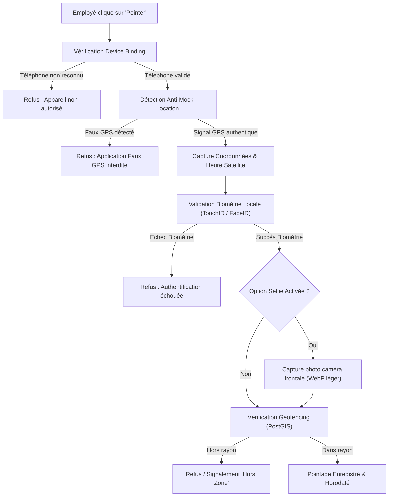

# Cahier des Charges & Spécifications Générales : Solution de Pointage Mobile Sécurisée

**Projet** : Application de pointage de présence géolocalisée et infalsifiable  
**Cible** : PME, commerces, entreprises de services, chantiers, ateliers  
**Philosophie** : **100% Logiciel — Zéro matériel physique — Zéro frais d'installation**

---

## 1. Objectifs & Périmètre

### 1.1 Objectifs Clés
- Remplacer les badgeuses et pointeuses physiques coûteuses par une solution mobile ultra-fiable.
- Garantir la présence physique effective des employés sur les lieux de travail.
- Fonctionner de façon fluide avec ou sans connexion Internet (résilience totale hors-ligne).
- Offrir aux gestionnaires et RH une visibilité instantanée sur la ponctualité, les retards et les heures réelles.

### 1.2 Périmètre Strict (Ce qui est inclus vs exclu)
- **Inclus** :
  - Application mobile multiplateforme unique (Android & iOS).
  - Tableau de bord web pour les gérants / managers / RH.
  - Moteur géospatial avec rayon de tolérance paramétrable.
  - Résilience hors-ligne avec horodatage satellite UTC.
  - Sécurité anti-triche logicielle (anti-faux GPS, liaison d'appareil, biométrie native).
  - Selfies éphémères légers (archivage visuel 24h puis suppression automatique).
- **Exclu (Choix délibéré)** :
  - Aucun matériel dédié (pas de tablettes murales, pas de bornes, pas de balises physiques).
  - Aucun tracking GPS continu (la position n'est lue qu'à la seconde précise du clic).
  - Aucune base de données d'empreintes ou de modèles biométriques sur le serveur (délégation complète à l'OS du smartphone).

---

## 2. Matrice Fonctionnelle

### 2.1 Espace Employé (Application Mobile Flutter)
* **Enrôlement 0-Mot de Passe (Double Canal : WhatsApp / Caméra)** :
  * **Cas A (Image WhatsApp / Galerie)** : L'employé reçoit l'image d'invitation chiffrée sur WhatsApp, l'enregistre dans ses photos et clique sur *"Importer depuis la galerie"*. L'application décode le jeton sans avoir besoin d'un second téléphone.
  * **Cas B (Scan Caméra)** : L'employé scanne le QR Code affiché sur l'écran du manager.
  * **Sécurité "Burn-on-First-Use"** : Le jeton cryptographique asymétrique (JWE) est valide sans limite de temps arbitraire, mais **définitivement brûlé et détruit dès la première activation**.
  * **Device Binding** : Enregistrement irrévocable de l'empreinte matérielle de l'appareil (`device_id`). Impossible de se connecter sur le téléphone d'un tiers.
* **Écran de Pointage (Interface 1-Clic)** :
  * Détection automatique de la zone de travail avec indicateur visuel (Vert = *Sur site*, Rouge = *Hors zone* avec distance affichée).
  * 4 statuts gérés :
    1. **Arrivée** (début de journée)
    2. **Départ Pause** (ex: pause déjeuner)
    3. **Retour Pause**
    4. **Départ** (fin de journée)
* **Validation d'un Pointage** :
  1. Clic sur le bouton de statut.
  2. Validation par biométrie locale de l'appareil (Face ID / Touch ID / Schéma sécurisé).
  3. Capture du selfie instantané (si option activée par l'entreprise).
  4. Confirmation visuelle immédiate du pointage avec heure officielle affichée.
* **Gestion Hors-Ligne (Offline-First)** :
  * Enregistrement chiffré dans la base locale (SQLite).
  * Horodatage via le signal satellite GPS (indépendant de l'horloge réseau ou utilisateur).
  * File d'attente automatique se synchronisant silencieusement dès le rétablissement de la 3G/4G/Wi-Fi.
* **Historique Personnel** :
  * Consultation de ses pointages de la semaine et du mois.
  * Formulaire de demande de régularisation en cas d'oubli ou d'anomalie justifiée.

### 2.2 Espace Administrateur / Manager (Dashboard Web)
* **Supervision Temps Réel (Vue "Aujourd'hui")** :
  * Tableau synoptique : Présents, En pause, Absents, En retard.
  * Détection automatique des **dépassements de pause** (`EXCESS_BREAK_DELAY`).
  * Filtrage instantané par établissement/agence.
* **Module de Justifications des Retards & Absences (100% Texte - Zéro Photo)** :
  * Traitement des motifs textuels déclarés (embouteillage, médical, mission).
  * Zéro stockage d'images lourdes pour préserver la légèreté et les coûts.
  * Décision en 1 clic : **[Approuver]** ou **[Refuser]**.
* **Relevé d'Assiduité & Heures Effectives (Export CSV)** :
  * Aucune gestion financière ni de montants de paie (rôle strictement limité au relevé des heures brutes).
  * Export en 1 clic au format Excel (CSV) des heures travaillées, retards et pauses.

---

## 3. Architecture de Sécurité Logique (Anti-Fraude)

1. **Anti-Faux GPS** : Blocage automatique si l'application détecte des positions simulées (`isMocked: true` ou mode développeur actif dédié au mock).
2. **Heure Satellite Inaltérable** : En mode hors-ligne, l'heure retenue est l'heure atomique UTC fournie directement par les trames des satellites GPS (impossible à truquer en changeant l'heure dans les paramètres Android/iOS).
3. **Double Horodatage d'Audit** :
   - `recorded_at_utc` : moment exact où le clic a eu lieu.
   - `synced_at_utc` : moment où le serveur a reçu la trame.
4. **Purge Éphémère Automatique (24h)** : Un tâche cron programmée côté base de données supprime physiquement les fichiers photos du stockage objet toutes les 24h pour optimiser l'espace disque et respecter la confidentialité.

---

## 4. Stack Technique Recommandée

| Composant | Technologie | Justification |
| :--- | :--- | :--- |
| **Application Mobile** | **Flutter (Dart)** | Code unique pour Android & iOS, performances natives, excellente gestion du GPS et de SQLite local. |
| **Backend & Base de données** | **Supabase (PostgreSQL + PostGIS)** | Fonctions géospatiales natives (`ST_DWithin`), authentification sécurisée intégrée, stockage d'images avec URL signées, tâche planifiée (pg_cron). |
| **Dashboard Web** | **Next.js / React (TailwindCSS)** | Dashboard réactif, moderne, rapide, accessible depuis n'importe quel ordinateur ou tablette sans rien installer. |
| **Stockage Fichiers (Selfies)** | **Supabase Storage / S3** | Fichiers d'environ 40-50 Ko avec suppression automatique via politique TTL à 24 heures. |

---

## 5. Modèle de Données Relationnel

### Tables Principales :
1. `organizations` : Entreprise cliente (nom, paramètres de sécurité).
2. `establishments` : Lieux de travail (nom, position GPS `geography(POINT)`, rayon de tolérance, BSSID Wi-Fi optionnel).
3. `users` : Employés et gestionnaires (nom, email, rôle, identifiant d'appareil autorisé `bound_device_id`).
4. `attendance_logs` : Registre des pointages (type, `recorded_at_utc`, `synced_at_utc`, position GPS réelle, distance calculée, statut de validation, URL de photo temporaire).
5. `attendance_adjustments` : Journal d'audit des corrections manuelles effectuées par les managers.
